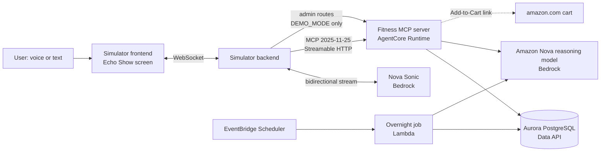

# Design

This is the agreed design for Dayform. It's the single source of truth for decisions, tools, data and services. Tickets point here; they don't repeat it. Only the orchestrator edits this file.

---

## 1. Agreed decisions

| # | Topic | Decision |
|---|---|---|
| D1 | Users | One user for the demo. Multi-user (Cognito + OAuth 2.1) comes later. |
| D2 | Scope | Nutrition (including water), training, body weight, meal prep, grocery cart. Out of scope: sleep, steps, heart rate. |
| D3 | Understanding | By default, Alexa's model fills in structured tool inputs. `UNDERSTANDING=server` switches each tool to one plain-text input, which the server's LLM turns into the same structured call. Both modes use the same core code. |
| D4 | Food data | A curated USDA subset (about 1,500 foods) plus a desi dish table. For foods neither covers, Opus estimates, and the entry is marked "estimated". Tracked: calories, protein, carbs, fat, fiber, sugar, sodium, iron, calcium, potassium, vitamin D. |
| D5 | Vague portions | Log a standard portion and return the assumption so Alexa can say it. The user fixes it by voice. Ask a follow-up only when the food can't be identified. |
| D6 | Training data | Strength: sets, reps, weight, optional RPE. Cardio: type, duration, distance. Exercise nicknames map to one exercise. PRs are tracked as estimated 1RM and as best weight for each rep count. |
| D7 | Live workout | Yes. Alexa runs the session: set targets, rest timers, set logging, summary. |
| D8 | Targets | Start targets come from Mifflin-St Jeor plus activity level. Every week, targets adapt to real intake and the weight trend. Protein is set per kg of body weight. The reason for each change is stored so Alexa can say it. |
| D9 | Buying | Alexa builds the cart and confirms it. The user checks out on Amazon. Alexa never places an order. |
| D10 | Switch | One env var, `UNDERSTANDING=alexa\|server`, defaulting to `alexa`. |
| D11 | LLM vs code | The reasoning model on Bedrock makes every judgment call. Code does arithmetic, storage and checks. LLM work stays out of the tool request path where possible (§7). |
| D12 | Alexa side | Nova 2.5 Sonic (or Nova 2 Sonic) is the simulated Alexa's voice and brain. Typed input also works. |
| D13 | Hosting | AgentCore Runtime in stateful mode, with SigV4 inbound auth. The same container runs locally in Docker. |
| D14 | Database | Aurora PostgreSQL Serverless v2 through the RDS Data API, with pg_trgm for fuzzy search. Local Postgres in Docker for development. |
| D15 | Cart | A curated grocery catalog with verified ASINs. The server holds the cart. Checkout asks for confirmation through elicitation, then hands off with an Amazon Add-to-Cart link. Links go through a `CartProvider` interface. |
| D16 | Visuals | Every tool returns `structuredContent`. Tools with a screen also attach an MCP Apps card (768×480). Without a screen, the reply is voice only. |
| D17 | Meal plans | Opus writes plans using catalog ingredients only. Code checks macros (±5%) and sends failures back for a fix. Output: recipes, one batch-cook session, a day-by-day plan, and a grocery list. No pantry step. |
| D18 | Overnight job | Runs nightly on EventBridge Scheduler, and on demand from "skip to morning". Produces the morning brief, weekly targets, next-session targets and a ready meal plan. The user hears it on "good morning". No push notifications. |
| D19 | Program | One pre-set 4-day program. Alexa progresses it and swaps exercises on request. No program building from scratch. |
| D20 | Demo profile | One seeded demo user with 6 weeks of history. A hidden demo panel offers reset, skip to morning, and short rest timers. |
| D21 | Reasoning model | **Amazon Nova only** (user decision, 2026-10-22). No Claude models on Bedrock. Primary: Nova 2 Lite (`us.amazon.nova-2-lite-v1:0`; Nova 2 Pro is not offered in us-east-1), fallback Nova Pro. T-00 confirmed both with a Converse call on 2026-10-22. Wherever a ticket says "Opus" or "Claude", read "the reasoning model". |

---

## 2. Architecture



- **Alexa side:** the simulator backend plus Nova Sonic. It hears the user, chooses tools, and speaks.
- **Server side:** the MCP server. It does lookups, maths, storage and Nova reasoning.
- **Overnight job:** one library, `runOvernight()`, that runs in three places: Lambda (nightly), the server's admin route (the demo button), and a CLI.

---

## 3. Alexa+ add-on rules

These come from Amazon's Alexa+ add-on docs, which the research step read on 2026-10-23. We follow them so the server would also work on a real Alexa+ device.

- **Protocol:** MCP **2025-11-25** over **Streamable HTTP**, at a public HTTPS endpoint.
- **Speed:** each tool call should finish in **under 500 ms**.
- **Sign-in (later, for multi-user):** OAuth 2.1 with authorization code and PKCE. Alexa+ doesn't support dynamic client registration yet, or a `WWW-Authenticate` header on a 401.
- **Tool design:**
  - One tool per customer intent, with no overlapping tools.
  - Each description says when to call the tool, why, and what it returns.
  - Declare only the parameters you honor. Output must match the declared schema.
  - Always return a result or an error.
- **Speech:** Alexa writes the spoken reply from your data. Return facts, not scripts.
- **Visuals:**
  - Link a tool to its MCP Apps card with `_meta.ui.resourceUri`.
  - Without a card, Alexa renders `structuredContent` itself, or replies by voice.
  - The canvas is 768×480.
- **Elicitation:** supported. Alexa first tries to fill missing details itself.
- **Server-to-client requests on AgentCore (T-03, 2026-10-22):** AgentCore answers the client's standalone GET stream with 405, so every `elicitInput()` (and any other server-to-client request) MUST pass `{ relatedRequestId: extra.requestId }` so it rides the tool call's own POST response stream. SDK 1.32.1 silently drops it otherwise (FRICTION F-009). T-20 and T-26 follow this.

Sources:
- https://developer.amazon.com/docs/alexaplus/add-ons/mcp-toolkit-quickstart.html
- https://developer.amazon.com/docs/alexaplus/add-ons/mcp-addon-tools-schema-data-design.html
- https://developer.amazon.com/docs/alexaplus/add-ons/mcp-toolkit-client-lifecycle.html

---

## 4. MCP tools

There are 18 tools. Exact schemas live in `packages/contracts/` (T-10). "Card" names refer to §5.

| Tool | The user wants to… | Key inputs (alexa mode) | Returns | Card | Ticket |
|---|---|---|---|---|---|
| `set_goals` | set or change their goal and stats | goal, rate_kg_per_week?, weight_kg?, activity? | new targets | rings | T-21 |
| `log_bodyweight` | record their weight | kg | trend, weekly change | — | T-21 |
| `log_meal` | record what they ate | items[{food, quantity?, unit?}], meal? | items, assumptions, day totals, remaining | meal-logged | T-22 |
| `correct_meal` | fix a logged meal | entry? (default: last), changes[] | updated entry, totals | meal-logged | T-22 |
| `log_water` | record water | ml or glasses | water today | rings | T-22 |
| `get_daily_summary` | see today's numbers | date? | totals vs targets, meals | rings | T-22 |
| `log_workout` | record a finished workout | exercise, sets[] or cardio | PR flags, summary | pr | T-23 |
| `get_progress` | see progress over time | metric, range_weeks? | series, summary | progress | T-23 |
| `start_workout` | begin today's session | day? | plan, first set target | workout | T-24 |
| `log_set` | record a set in the session | reps, weight?, rpe? | next target, rest, PR flag | workout or pr | T-24 |
| `swap_exercise` | replace an exercise | exercise?, reason? | new exercise, target | workout | T-24 |
| `finish_workout` | end the session | — | summary, PRs | pr | T-24 |
| `plan_meal_prep` | get a meal-prep plan | days?, constraints? | plan, or status "preparing" | meal-prep | T-25 |
| `add_to_cart` | add groceries | from_plan? or items[] | cart | cart | T-26 |
| `remove_from_cart` | remove groceries | item, quantity? | cart | cart | T-26 |
| `view_cart` | see the cart | — | cart | cart | T-26 |
| `checkout_cart` | send the cart to Amazon | — (confirmed through elicitation) | link, total | cart | T-26 |
| `get_morning_brief` | hear the morning brief | — | brief | brief | T-27 |

If the host can't do elicitation (fallback from T-03), set `CHECKOUT_CONFIRM=tool`. A 19th tool, `confirm_checkout`, then completes the checkout (T-26).

---

## 5. Cards

There are 8 cards, each 768×480, built in T-32 and served as `ui://cards/<name>`:

| Card | Shows | Used by |
|---|---|---|
| `rings` | Calories, protein, carbs and fat as rings against targets, plus water | `get_daily_summary`, `set_goals`, `log_water` |
| `meal-logged` | Items with portions, an "assumed" badge, an "estimated" badge, and meal totals | `log_meal`, `correct_meal` |
| `workout` | Exercise, set X of Y, target weight × reps, rest countdown | `start_workout`, `log_set`, `swap_exercise` |
| `pr` | PR celebration: lift, new estimated 1RM, change | `log_set`, `log_workout`, `finish_workout` |
| `progress` | 6-week line chart with a summary | `get_progress` |
| `meal-prep` | Carousel: days, meals, macros per day, batch-cook steps | `plan_meal_prep` |
| `cart` | Items, packs, estimated total, "Open Amazon cart" button, QR code | cart tools |
| `brief` | Yesterday, one insight, today's workout and targets, the reason targets changed | `get_morning_brief` |

---

## 6. Data model

These are tables for one user. The exact schema is in `db/` (T-11).

- `profile`: sex, birth year, height, activity, goal, rate, protein per kg, preferences (cuisines, dislikes, allergies, equipment, maximum prep time), check-in weekday.
- `targets`: effective date, kcal, protein, carbs, fat, fiber, sodium, water, reason codes, reason text, source (`initial`, `weekly`, `manual`).
- `foods`: name, aliases, nutrients per 100 g, portions (name → grams), default portion, source, priority. Trigram index on name and aliases. **Food IDs are stable slugs** (orchestrator, 2026-10-22): desi dishes use the lowercase hyphenated name (`roti`, `chicken-karahi`, `mango-lassi`, `chicken-biryani`, `daal-chawal`, `aloo-paratha`, `raita`, `nihari`, `naan`, `chana-chaat`, …); USDA foods use `usda-<fdc_id>`. T-11 seeds and T-13 catalog reference foods by these slugs.
- `meal_entries` and `meal_items`: time, meal type, food, words the user said, quantity, unit, grams, nutrients, estimated flag, assumptions.
- `water_logs`, `bodyweight_logs`.
- `exercises`: name, aliases, type, muscle, equipment, alternatives.
- `program_days` and `program_exercises`: the pre-set program.
- `workout_sessions`, `sets`, `cardio_logs`: session state and the MCP session ID; sets with PR flags.
- `next_targets`: for date, exercise, weight, reps, reason.
- `meal_plans`: status (`ready`, `preparing`, `failed`), date range, plan JSON, totals, within-tolerance flag.
- `catalog_items`: name, ASIN, pack size, price and price date, food ID, URL, verified at.
- `cart_items`, `cart_checkouts`.
- `briefs`: for date, brief JSON.
- `demo_clock`: current demo time, timer speed.

---

## 7. LLM and code

| The reasoning model does (judgment) | Code does (facts and checks) |
|---|---|
| Estimates foods the food table can't match | Food search, portions, nutrient maths |
| Writes meal-prep plans | Checks plan macros (±5%) and does the grocery maths |
| Reviews next-session targets within guardrails | Double progression, guardrails, estimated 1RM, PR detection |
| Explains why targets changed | Adaptive expenditure maths and the ±250 kcal weekly cap |
| Writes the morning brief and its insight | Checks every number in the brief against the database |
| Parses plain text in server mode | Validates the result against the tool's schema |

**Rules:**
- Every LLM output passes a zod schema and a code check before it's stored.
- The confident path of a tool call makes no LLM call. That keeps tools under 500 ms.
- Slow LLM work runs in the overnight job, or in the background with progress messages.
- The tools allowed to go over 500 ms: `log_meal` with an unknown food, `plan_meal_prep` with new constraints, and everything in server mode.

---

## 8. Demo controls

- **Seed state:** the database state after `db:reset`. It holds the demo user with 6 weeks of history (T-11). Every take starts from the seed state.
- **Demo clock:** when `DEMO_MODE=true`, all code reads time from `clock.now()`, which reads the `demo_clock` table. The seed sets the clock to 13:00 on demo day.
- **Admin routes** (server, `DEMO_MODE=true` only, protected by `ADMIN_TOKEN`):
  - `POST /admin/reset`: reset to the seed state.
  - `POST /admin/advance-day`: run the overnight job, then set the clock to 07:00 the next day.
  - `POST /admin/timer-speed`: shorten rest timers (for example, 10 s).
  - `GET /admin/status`.
- **Cached overnight:** `OVERNIGHT_MODE=cached` loads stored overnight output, so S5 is instant and the same every take. `live` runs Opus for real.
- **Demo panel:** a hidden panel in the simulator (T-31) that calls the admin routes.

---

## 9. Environment variables

| Variable | Values | Used by |
|---|---|---|
| `AWS_REGION` | `us-east-1` | all |
| `AWS_PROFILE` | `hirz-login` (account root; user decision 2026-10-22) | all, local only |
| `REASONING_MODEL_ID` | Nova reasoning model ID (D21; recorded in T-00 and T-01). Confirmed by T-00 on 2026-10-22: `us.amazon.nova-2-lite-v1:0` (Nova 2 Pro is not offered in us-east-1) | server, jobs |
| `REASONING_MODEL_FALLBACK_ID` | `us.amazon.nova-pro-v1:0` (confirmed by T-00) | server, jobs |
| `VOICE_MODEL_FALLBACK_ID` | `amazon.nova-2-sonic-v1:0` | simulator backend |
| `VOICE_MODEL_ID` | `amazon.nova-2-5-sonic` (Nova 2.5 Sonic, authorized per T-00; T-02 confirms it works) | simulator backend |
| `ALEXA_VOICE` | Sonic voice ID, for example `tiffany` | simulator backend |
| `UNDERSTANDING` | `alexa` (default), `server` | server |
| `VOICE_ENGINE` | `sonic` (default), `pipeline`, `text` | simulator backend |
| `MCP_URL` | `http://localhost:8001/mcp` (real server on this laptop: host port 8000 is taken by another project's container, so local dev and compose map the server to 8001; inside the container it still listens on 8000 per the AgentCore contract), `http://localhost:8100/mcp` (mock), or the AgentCore invoke URL | simulator backend, mock |
| `MCP_AUTH` | `none`, `sigv4` | simulator backend |
| `DB_DRIVER` | `pg`, `data-api` | server, jobs, db |
| `DATABASE_URL` | local Postgres URL | `pg` driver |
| `AURORA_CLUSTER_ARN`, `AURORA_SECRET_ARN`, `AURORA_DATABASE` | from T-04 or T-40 | `data-api` driver |
| `DEMO_MODE` | `true`, `false` | server |
| `ADMIN_TOKEN` | random string | server, simulator backend |
| `OVERNIGHT_MODE` | `live`, `cached` | server, jobs |
| `CHECKOUT_CONFIRM` | `elicitation` (default), `tool` | server |
| `CARDS_MODE` | `mcp-apps` (default), `native` | simulator frontend |
| `MOCK_PASSTHROUGH_URL`, `REAL_TOOLS` | hybrid mock settings (T-10) | mock |

---

## 10. Services and fallbacks

The orchestrator updates the **Chosen** column at Gate G0.

| Need | Primary | Smoke test | Fallbacks, in order | Chosen |
|---|---|---|---|---|
| Reasoning LLM | Amazon Nova 2 Lite on Bedrock (D21; Nova 2 Pro not offered in us-east-1) | T-01 | Nova Pro | **Nova 2 Lite** `us.amazon.nova-2-lite-v1:0` (PASS 2026-10-22; ~650 ms per call; long forced-tool JSON is flaky, validate and retry) |
| Alexa voice | Nova 2.5 Sonic | T-02 | Nova 2 Sonic → Sonic in us-west-2 → Transcribe + Nova + Polly → Web Speech + Polly → text + Polly | **Nova 2.5 Sonic** `amazon.nova-2-5-sonic`, voice tiffany (PASS; tool turns ~1.2 s to first audio; renew session before 8 min) |
| MCP hosting | AgentCore Runtime (stateful, SigV4) | T-03 | ECS Fargate + ALB sticky sessions → Lambda + two-step confirm → local server | **AgentCore** (PASS; ping p50 118 ms, elicitation 230 ms with relatedRequestId; CloudFormation L1 deploy via smoke/agentcore-mcp/deploy.sh) |
| Database | Aurora PG Serverless v2 + Data API | T-04 | Aurora direct connection in a VPC → RDS PostgreSQL → local Postgres → DynamoDB + in-memory search | **Aurora 17.11 + Data API** (PASS; p50 81 ms from laptop), Drizzle ORM 0.45 with node-postgres locally; cluster `dayform-db` |
| Cart hand-off | Amazon Add-to-Cart link | T-05 | Search links → Amazon Fresh search links → QR code + product pages | **`https://www.amazon.com/associates/addtocart?AssociateTag=dayform-20&ASIN.n=…&Quantity.n=…`** (PASS 2026-10-22, signed in; the legacy `/gp/aws/cart/add.html` form opens an empty cart, F-011). Builder: smoke/amazon-cart/build-link.ts. T-26's `AmazonCartLinkProvider` uses this form. |
| Cards | MCP Apps (`@modelcontextprotocol/ext-apps`) | T-06 | Native React cards from `structuredContent` | **MCP Apps** (PASS; callback works; ~600 KB bundle) |
| Scheduler | EventBridge Scheduler + Lambda | T-07 | In-process job through the admin route | **EventBridge Scheduler + Lambda nodejs24.x** (PASS; stack `dayform-smoke-scheduler-lambda`) |
| Food data | USDA FoodData Central bulk CSV | T-12 | FDC API (key) → Opus estimate | — |

**Known versions on 2026-10-23:**
- `@modelcontextprotocol/sdk` 1.32.1: latest protocol is 2025-11-25.
- `@modelcontextprotocol/ext-apps` 2.0.3. It peers on the split SDK v2 packages (`@modelcontextprotocol/client|core|server` 2.3.1), see FRICTION F-001. **Decision (orchestrator, 2026-10-22, from T-06):** the server (T-03, T-20) stays on `@modelcontextprotocol/sdk` 1.32.1; cards (T-32) use ext-apps 2.0.3 with the `as any` cast on `registerAppTool`/`registerAppResource` that T-06 proved; the wire protocol is identical. Card resource MIME type: `text/html;profile=mcp-app`.

---

## 11. Repo layout

`dayform/` is both the plan folder and the code repo.

```
dayform/
  PLAN.md  DESIGN.md  DEMO-SCRIPT.md  DEMO-MONITOR.md  SMOKE-RESULTS.md  FRICTION.md
  tickets/                 one file per ticket
  smoke/                   Wave 0 smoke tests, one folder per ticket
  packages/contracts/      tool schemas, card data types, simulator events, admin types
  packages/food-search/    food matching and portion resolution
  server/                  MCP server: src/core, src/tools/<domain>, src/domain/<domain>
  simulator/backend/       Nova Sonic relay, MCP client, events, admin proxy
  simulator/frontend/      React Echo Show screen
  cards/                   card components and single-file HTML builds
  jobs/overnight/          runOvernight library, Lambda handler, cache
  db/                      schema, migrations, seed, reset
  data/                    foods/, catalog/, exercises/, program/
  infra/                   CDK app
  mock/                    mock MCP server with fixtures and hybrid mode
  demo/                    Demo Monitor: scene runner, warm-up script, screenshots
  video/                   shot list, captions, assets (raw video stays out of git)
```

---

## 12. Demo-first simplifications

- **One user.** No sign-in (D1).
- **Food table:** about 1,500 curated foods plus desi dishes, not the full USDA set. No vector search.
- **Grocery catalog:** about 40 items, limited to what meal plans use.
- **Aurora capacity:** at least 0.5 ACU while building and recording, so there's no wake-up delay.
- **Nova Sonic:** reconnects automatically before its 8-minute session cap.
- **Program:** pre-set (D19), with no program builder.
- **Meal plans:** no pantry step (D17).
- **Overnight output:** cached for recording (§8).
- **Rest timers:** shortened in demo mode.

---

## 13. Glossary

- **Tool:** one MCP tool from §4.
- **Card:** one MCP Apps screen from §5.
- **Scene:** one part of the demo script (S1–S7).
- **Take:** one recording attempt.
- **Seed state:** the database state after a reset.
- **Demo clock:** the time the system thinks it is in demo mode.
- **Alexa side:** the simulator plus Nova Sonic.
- **Server side:** the MCP server, the database and Opus.
- **Gate:** a check that must pass before the next wave starts.
- **Fallback:** a replacement service, used when the primary fails.
- **Hand-off:** a ticket agent's final report to the orchestrator.
