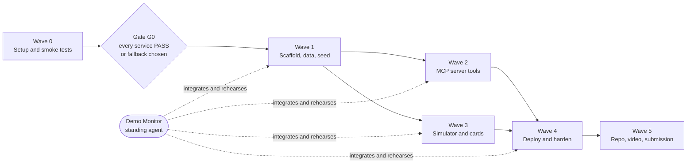

# Dayform: Build Plan

Dayform is an Alexa+ add-on. You talk to Alexa, and Alexa:
- logs your meals and workouts
- runs your gym session
- plans your meal prep
- fills your Amazon cart

The add-on is a self-hosted MCP server. A web simulator plays the part of an Alexa+ device with a screen.

- **Hackathon:** Build, Ship, Shape (Amazon Developer).
- **Entries:** the **Alexa+** track and the **AWS Builder** mini challenge.
- **Deadline:** 2026-10-23 12:00 PT (2026-10-24 00:00 PKT).
- **Rule for all work: the demo comes first.** Put effort where the judges see it. Simplify everything else.

**Read order for every agent:** this file, then [DESIGN.md](DESIGN.md), then your ticket file.

---

## 1. How we work

This plan uses **subagent-driven development**:
- One orchestrator runs the plan.
- One fresh agent does each ticket.
- One standing Demo Monitor keeps the demo alive the whole time.

### 1.1 Roles

| Role | Who | Job |
|---|---|---|
| Orchestrator | The main Claude session | Sends tickets to agents. Merges finished work. Runs the gates. Talks to the user. Owns this file and DESIGN.md. |
| Ticket agent | One fresh subagent per ticket | Completes one ticket. Works only in the paths its ticket owns. |
| Demo Monitor | One standing subagent, from Gate G0 to submission | Builds and runs the demo from the parts that exist. Owns [DEMO-SCRIPT.md](DEMO-SCRIPT.md). Agrees the final script with the orchestrator. Brief: [DEMO-MONITOR.md](DEMO-MONITOR.md). |
| User | Human | Does the human steps (§1.6). Approves external changes (§1.5). Records the video. Submits on Devpost. |

### 1.2 Dispatch

The orchestrator sends each ticket agent this prompt:

> You are the ticket agent for T-XX. Read PLAN.md (sections 1 and 2), DESIGN.md, and tickets/T-XX-*.md. Do the ticket. Work only in the paths under "Owns". Update the Status line as you work. Fill in the Result section at the end of the ticket. Finish with the hand-off report from PLAN.md §1.4.

- Ticket agents work directly in the main tree (user decision 2026-10-22: tickets own disjoint paths, so worktrees only add merge time). The orchestrator commits each ticket when it passes.
- Run at most 5 ticket agents at the same time, plus the Demo Monitor.
- Start the Demo Monitor when Gate G0 passes. Keep it running until submission.

### 1.3 Rules for ticket agents

1. **Read before you build.** Read your whole ticket before you write code.
2. **Stay in your paths.** Write only in the paths under **Owns**. For a change anywhere else, ask the orchestrator.
3. **Use the contracts.** Tool inputs, tool outputs, card data and simulator events live in `packages/contracts/`. If a contract needs to change, put the change in your hand-off. The orchestrator makes it.
4. **Use fallbacks in order.** If a service fails, use the fallbacks in your ticket, in the order given. Record the switch in [SMOKE-RESULTS.md](SMOKE-RESULTS.md) (Wave 0) or in your Result section (later waves).
5. **Log friction when it happens.** When a tool, SDK or AWS service blocks or surprises you, add an entry to [FRICTION.md](FRICTION.md) at once. These entries become the Devpost friction log, which is worth up to a 10% judging bonus.
6. **Keep secrets in `.env.local`.** Git ignores that file. Put names, not values, in `.env.example`.
7. **Done means proven.** A ticket is done when every acceptance criterion passes and the test scenario runs green.

### 1.4 Status and hand-off

**Status values:**
- TODO → IN PROGRESS → REVIEW → DONE
- BLOCKED (add the reason)
- CUT

The agent edits the Status line in its ticket file.

**Hand-off report.** Send this to the orchestrator, 15 lines at most:

```
T-XX · <status>
Built: <one line per deliverable>
Verify: <exact command or commands>
Acceptance: <passed>/<total> (name any that fail)
Deviations: <changes from the ticket, and why>
Fallbacks used: <service → replacement>
Demo risks: <short list>
Friction entries added: <count>
```

**Merging.** The orchestrator merges a ticket when two things are true:
- its test scenario passes on the main branch
- the Demo Monitor reports no regression

### 1.5 Approval rule

Any change outside this folder needs the user's explicit "yes" for **that** change. This includes:
- creating, changing or deleting AWS resources
- installing packages on the machine
- creating GitHub repos, or pushing to them
- accepting any terms
- signing in to any account

Ticket agents ask the orchestrator, and the orchestrator asks the user. One approval covers one change. Each ticket marks these steps **Approval needed**.

### 1.6 Human steps

Only the user can do these. Agents prepare each step (a `wizard` script is a good format), then wait for the user.

| Step | Ticket |
|---|---|
| Sign in to AWS (`aws configure sso` or access keys) | T-00 |
| Request Bedrock model access, and accept model terms if asked | T-00 |
| Sign in to amazon.com for the cart tests | T-05, T-13, T-26 |
| Create the GitHub repo and approve the push | T-50 |
| Record and upload the video | T-51 |
| Fill in and submit the Devpost form | T-52 |

---

## 2. Demo importance and size

**Demo importance** decides how much effort a ticket gets.

| Level | Meaning | Effort rule |
|---|---|---|
| **HERO** | Seen in a hero scene. Judges will remember it. | Make it flawless and polished. |
| **VISIBLE** | Seen on screen, but in a supporting role. | Make it correct and clean. |
| **ENABLER** | Not seen. A HERO or VISIBLE item depends on it. | Make it work. Skip polish. |
| **REQUIRED** | Not seen. The hackathon rules or the submission need it. | Meet the rule exactly. |
| **CUT-FIRST** | Not seen, or barely seen. | Do the minimum. Drop it first when behind. |

**Size** is relative effort: **S** (small), **M** (medium), **L** (large).

---

## 3. Waves and gates



- **Wave 0 is a gate.** First-time setup of AWS services is slow and can fail, so every service is tested before any feature is built.
- **Gate G0 passes when** each smoke ticket (T-01 to T-07) is PASS, or has a fallback that PASSes.
  - The orchestrator reviews [SMOKE-RESULTS.md](SMOKE-RESULTS.md) with the user.
  - Then it updates [DESIGN.md §10](DESIGN.md#10-services-and-fallbacks) with the chosen services.
  - Only then does Wave 1 start.
- **Waves 2 and 3 run in parallel.** The simulator and the cards are built against the mock server from T-10, so they don't wait for the real tools.
- **Critical path:** T-00 → T-03 → T-10 → T-20 → T-25 → T-26 → T-41 → T-51 → T-52.

---

## 4. Ticket index

### Wave 0: Setup and smoke tests

| Ticket | Brief | Importance | Size | Depends on |
|---|---|---|---|---|
| [T-00](tickets/T-00-aws-access-and-tooling.md) AWS access and tooling | Get AWS sign-in, Bedrock model access, CDK and ARM64 builds ready. | ENABLER | S | — |
| [T-01](tickets/T-01-smoke-claude-bedrock.md) Smoke: Nova on Bedrock | Nova reasoning model (D21) tool use, valid JSON, streaming, latency. | ENABLER | S | T-00 |
| [T-02](tickets/T-02-smoke-nova-sonic.md) Smoke: Nova Sonic voice | Browser voice round trip with a tool call. Test how well it hears desi food words. | ENABLER | M | T-00 |
| [T-03](tickets/T-03-smoke-agentcore-mcp.md) Smoke: MCP on AgentCore | Stateful MCP 2025-11-25 server with elicitation. Latency. | ENABLER | M | T-00 |
| [T-04](tickets/T-04-smoke-aurora.md) Smoke: Aurora + Data API | Fuzzy food search (pg_trgm) from the laptop and from AWS. Choose the DB library. | ENABLER | S | T-00 |
| [T-05](tickets/T-05-smoke-amazon-cart-link.md) Smoke: Amazon cart link | Prove real products land in the user's Amazon cart. | ENABLER | S | — |
| [T-06](tickets/T-06-smoke-mcp-apps.md) Smoke: MCP Apps card | Show a live card at 768×480 in our own host page. | ENABLER | S | — |
| [T-07](tickets/T-07-smoke-scheduler-lambda.md) Smoke: Scheduler + Lambda | A scheduled Lambda calls Opus and writes to Aurora. | CUT-FIRST | S | T-00, T-04 |

### Wave 1: Scaffold, data, seed

| Ticket | Brief | Importance | Size | Depends on |
|---|---|---|---|---|
| [T-10](tickets/T-10-scaffold-contracts-mock.md) Scaffold, contracts, mock | Repo structure, shared tool contracts, and a mock MCP server with hybrid mode. | ENABLER | M | G0 |
| [T-11](tickets/T-11-database-seed-reset.md) Database, seed, reset | Schema, exercise list, pre-set program, 6 weeks of demo history, reset in seconds. | VISIBLE | M | T-10, T-12 |
| [T-12](tickets/T-12-food-data-search.md) Food data and search | 1,500 foods plus desi dishes, at least 95% match accuracy. | HERO | L | T-10, T-02 |
| [T-13](tickets/T-13-grocery-catalog.md) Grocery catalog | About 40 grocery items with verified Amazon ASINs. | VISIBLE | M | T-10, T-12, T-05 |

### Wave 2: MCP server tools

| Ticket | Brief | Importance | Size | Depends on |
|---|---|---|---|---|
| [T-20](tickets/T-20-mcp-server-core.md) MCP server core | Transport, tool registry, card resources, LLM client, demo clock, admin routes. | ENABLER | M | T-10, T-03, T-04 |
| [T-21](tickets/T-21-goals-and-targets.md) Goals and targets | `set_goals`, `log_bodyweight`, weekly adaptive targets. | VISIBLE | M | T-20, T-11 |
| [T-22](tickets/T-22-meal-logging.md) Meal logging | `log_meal`, `correct_meal`, `log_water`, `get_daily_summary`. | HERO | M | T-20, T-12, T-21 |
| [T-23](tickets/T-23-workouts-prs-progress.md) Workouts, PRs, progress | `log_workout`, `get_progress`, exercise names and nicknames, PR detection. | VISIBLE | M | T-20, T-11 |
| [T-24](tickets/T-24-live-workout.md) Live workout | `start_workout`, `log_set`, `swap_exercise`, `finish_workout`. | HERO | M | T-23, T-11 |
| [T-25](tickets/T-25-meal-prep-planner.md) Meal-prep planner | Opus builds plans from catalog items only; code checks they're within 5% of targets. | HERO | L | T-20, T-12, T-13, T-21 |
| [T-26](tickets/T-26-cart-checkout.md) Cart and checkout | Cart tools, elicitation confirm, Amazon cart link. | HERO | M | T-20, T-13, T-25 |
| [T-27](tickets/T-27-overnight-job-brief.md) Overnight job and brief | The overnight prep job and `get_morning_brief`, with a cached mode. | HERO | M | T-21, T-24, T-25 |
| [T-28](tickets/T-28-server-understanding-mode.md) Server understanding mode | `UNDERSTANDING=server`: Opus parses plain-text requests. | CUT-FIRST | S | T-22, T-24 |

### Wave 3: Simulator and cards

| Ticket | Brief | Importance | Size | Depends on |
|---|---|---|---|---|
| [T-30](tickets/T-30-simulator-backend.md) Simulator backend | Nova Sonic voice, MCP client, events to the screen, fallback voice engines. | HERO | L | T-10, T-02, T-03 |
| [T-31](tickets/T-31-simulator-frontend.md) Simulator frontend | Echo Show screen, light bar, "Under the hood" panel, demo panel. | HERO | L | T-10, T-32 |
| [T-32](tickets/T-32-cards.md) Cards | 8 animated MCP Apps cards, plus native React fallbacks. | HERO | L | T-10, T-06 |

### Wave 4: Deploy and harden

| Ticket | Brief | Importance | Size | Depends on |
|---|---|---|---|---|
| [T-40](tickets/T-40-deploy-aws.md) Deploy to AWS | CDK for Aurora, AgentCore and Lambda. Point the simulator at AgentCore. | VISIBLE | M | T-20, T-11, T-27 |
| [T-41](tickets/T-41-demo-hardening.md) Demo hardening | Warm-up script, scene runner, failure drills, script v1. Owned by the Demo Monitor. | HERO | M | all HERO tickets, T-40 |

### Wave 5: Repo, video, submission

| Ticket | Brief | Importance | Size | Depends on |
|---|---|---|---|---|
| [T-50](tickets/T-50-readme-repo.md) README and repo | Judge-ready public repo with MIT license and a fresh-clone test. | REQUIRED | S | T-40 |
| [T-51](tickets/T-51-video.md) Video | Under 3 minutes, every hero scene, public on YouTube. | HERO | M | T-41 |
| [T-52](tickets/T-52-devpost-submission.md) Devpost submission | Every field drafted: description, product feedback, friction log. | REQUIRED | S | T-50, T-51 |
| [T-53](tickets/T-53-open-source-simulator.md) Open-source simulator | Standalone simulator repo for the Open Source mini challenge. | CUT-FIRST | S | T-30, T-31 |

---

## 5. Cut order

When the plan runs behind, cut in this order:
1. T-53, the open-source simulator repo.
2. T-28, server understanding mode. Keep the env switch and log "not implemented".
3. T-07, the nightly schedule. The demo uses the "skip to morning" button.
4. Live Opus during "skip to morning". Use `OVERNIGHT_MODE=cached`.
5. `swap_exercise` and `log_water`.
6. AgentCore hosting for the recording. Run the server locally, and show the T-03 AgentCore clip in S7.
7. MCP Apps cards. Use the native React cards (same components, see T-32).

**Keep at all costs:** scenes S1, S3, S4 and S5 in [DEMO-SCRIPT.md](DEMO-SCRIPT.md).

---

## 6. Files

| File | Owner | Purpose |
|---|---|---|
| PLAN.md | Orchestrator | This file: process, ticket index, cut order. |
| [DESIGN.md](DESIGN.md) | Orchestrator | Agreed design: decisions, tools, data, services, fallbacks. |
| [DEMO-SCRIPT.md](DEMO-SCRIPT.md) | Demo Monitor | Scenes, lines, readiness matrix, recording checklist. |
| [DEMO-MONITOR.md](DEMO-MONITOR.md) | Orchestrator | Brief for the Demo Monitor agent. |
| [SMOKE-RESULTS.md](SMOKE-RESULTS.md) | Wave 0 agents | Smoke test results and Gate G0 decision. |
| [FRICTION.md](FRICTION.md) | All agents (append only) | Raw friction entries for the Devpost friction log. |
| `tickets/` | One agent per ticket | Full detail for each ticket. |
