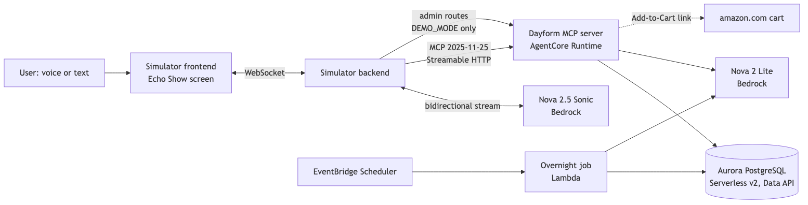
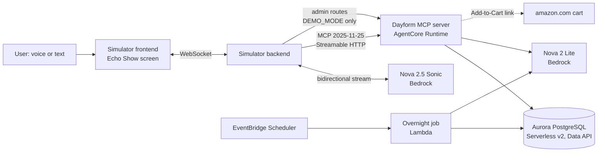

# Dayform

**Talk to Alexa to log meals and workouts, run a live gym session, plan your meal prep and fill your Amazon cart.**

Dayform is an Alexa+ add-on: a self-hosted MCP server with 18 tools and 8 MCP Apps cards. A web simulator plays the part of an Echo Show, with Amazon Nova 2.5 Sonic as Alexa's voice. Amazon Nova 2 Lite on Bedrock makes the judgment calls; code does the arithmetic, storage and checks.

Demo video: _link added after recording_

Repository: https://github.com/BashaarJavaid/Dayform

> Built for Build, Ship, Shape: Amazon Developer Hackathon (Alexa+ track, AWS Builder mini challenge).

## What it does

- **"I had two rotis, chicken karahi and a mango lassi for lunch."** Dayform matches each food (desi dishes included), assumes a standard portion where you didn't say one and tells you so, and shows calories and protein left for today. "Actually, make that one roti" fixes it.
- **"Start push day."** Alexa runs the session: target weight and reps for each set, rest timers, PR detection by estimated 1RM, and exercise swaps ("my shoulder feels off, swap the overhead press").
- **"Plan my meal prep for the next four days and add what I need to my cart."** Nova writes a plan from catalog ingredients only; code checks every day is within 5% of your targets, works out the groceries, and fills a cart. Alexa asks you to confirm, then hands you an Amazon Add-to-Cart link. Alexa never places the order.
- **"Good morning."** An overnight job has already checked your week: targets adapt to your real intake and weight trend (capped at ±250 kcal a week), and the brief tells you why. Every number in it is checked against the database.
- **"How's my bench going?"** A 6-week progress chart.

## Architecture





- **MCP server entry point:** [`server/src/main.ts`](server/src/main.ts). The server is built in [`server/src/app.ts`](server/src/app.ts) (`McpServer` + `StreamableHTTPServerTransport` from `@modelcontextprotocol/sdk`), tools are registered in [`server/src/core/registry.ts`](server/src/core/registry.ts), and the tool handlers live in `server/src/tools/<domain>`.
- **Tool contracts** (zod input and output schemas, card data): [`packages/contracts/src/tools`](packages/contracts/src/tools).
- **Model vs code:** Nova estimates unknown foods, writes meal plans, reviews next-session targets and writes the morning brief. Code does food search, nutrient maths, the ±5% plan check, PR detection, progression and target maths. Every model output passes a zod schema and a code check before it is stored.
- **Overnight job:** one library, `runOvernight()` in [`jobs/overnight`](jobs/overnight), runs from Lambda (nightly), from the demo's "skip to morning" admin route, and from a CLI.

Regenerate the PNG after editing [`docs/architecture.mmd`](docs/architecture.mmd): `npx -y @mermaid-js/mermaid-cli@11.4.2 -i docs/architecture.mmd -o docs/architecture.png -w 1600 -b white`.

## Alexa+ add-on compliance

Dayform follows Amazon's [Alexa+ add-on MCP guidance](https://developer.amazon.com/docs/alexaplus/add-ons/mcp-addon-tools-schema-data-design.html) so the same server would work on a real Alexa+ device.

- **Protocol:** MCP **2025-11-25** over **Streamable HTTP** with **stateful sessions** (`Mcp-Session-Id`), `@modelcontextprotocol/sdk` 1.32.1. Deployed on Amazon Bedrock AgentCore Runtime in stateful mode with SigV4 inbound auth.
- **One tool per intent,** no overlapping tools. Each description says when to call it, why, and what it returns. Only honored parameters are declared, and every result matches its declared `outputSchema` and returns `structuredContent`. Every call returns a result or an error. Results are facts, not scripts: Alexa writes the reply.
- **Elicitation for checkout:** `checkout_cart` asks the user to confirm the items and total with a form elicitation. Each `elicitInput()` passes `relatedRequestId`, so the request rides the tool call's own POST response stream (AgentCore answers the standalone GET stream with 405). If a host can't do elicitation, `CHECKOUT_CONFIRM=tool` adds a 19th tool, `confirm_checkout`, for a two-step confirm.
- **MCP Apps cards at 768×480:** tools with a screen link to their card with `_meta.ui.resourceUri` (`ui://cards/<name>`, MIME `text/html;profile=mcp-app`, built with `@modelcontextprotocol/ext-apps` 2.0.3). Without a screen the reply is voice only.
- **Speed:** each tool call targets under 500 ms. The confident path makes no model call; on a local run the demo tools answer in 3–91 ms. Only `log_meal` with an unknown food, `plan_meal_prep` with new constraints, and server understanding mode may go over.

## Tools

Generated from the contracts with `npx tsx docs/gen-tools.ts`.

<!-- tools:start -->
| Tool | Called when | Inputs (alexa mode) | Card |
|---|---|---|---|
| `set_goals` | the user wants to set or change their goal (lose, maintain or gain weight), their weekly rate, their current weight or their activity level | goal, rate_kg_per_week?, weight_kg?, activity? | `rings` |
| `log_bodyweight` | the user tells you their body weight | kg | none |
| `log_meal` | the user says what they ate or drank (other than plain water) | items, meal? | `meal-logged` |
| `correct_meal` | the user corrects a meal they already logged, e.g. 'actually, make that one roti' or 'I didn't have the lassi' | entry_id?, changes | `meal-logged` |
| `log_water` | the user says they drank water | ml?, glasses? | `rings` |
| `get_daily_summary` | the user asks how their day is going, what they have eaten, or how much they have left | date? | `rings` |
| `log_workout` | the user reports an exercise they already finished outside a live session, e.g. 'I did 3 sets of 5 squats at 100 kg' or 'I ran 5 km in 28 minutes' | exercise, sets?, cardio? | `pr` |
| `get_progress` | the user asks how they are progressing over time: a lift ('how's my bench going?'), body weight, calories or protein | metric, exercise?, range_weeks? | `progress` |
| `start_workout` | the user wants to start a live gym session now, e.g. 'start push day' | day? | `workout` |
| `log_set` | during a live session when the user finishes a set, e.g. 'done, eight reps' | reps, weight_kg?, rpe? | `workout` |
| `swap_exercise` | during a live session when the user wants to replace an exercise, e.g. 'my shoulder feels off, swap the overhead press' | exercise?, reason? | `workout` |
| `finish_workout` | the user ends the live session, e.g. 'I'm done' or 'finish workout' | none | `pr` |
| `plan_meal_prep` | the user wants a meal-prep plan for the coming days | days?, constraints? | `meal-prep` |
| `add_to_cart` | the user wants groceries added to their cart: everything the current meal-prep plan needs (from_plan), or named items | from_plan?, items? | `cart` |
| `remove_from_cart` | the user wants an item taken out of the cart, or fewer packs of it | item, quantity? | `cart` |
| `view_cart` | the user asks what is in their cart | none | `cart` |
| `checkout_cart` | the user wants to send their cart to Amazon | none | `cart` |
| `get_morning_brief` | the user greets you in the morning ('good morning') or asks for their brief | none | `brief` |
| `confirm_checkout` (only with `CHECKOUT_CONFIRM=tool`) | after checkout_cart returned status 'awaiting_confirmation' and you have read the items and total to the user | confirm | `cart` |
<!-- tools:end -->

Cards: `rings`, `meal-logged`, `workout`, `pr`, `progress`, `meal-prep`, `cart`, `brief` (source in [`cards/`](cards), built single-file HTML in `cards/dist/`).

## Run locally

Requirements: Node 22 or later, Docker, and (for the voice and model parts) an AWS account with Bedrock access to Nova 2 Lite and Nova 2.5 Sonic in `us-east-1`. The scene runner below does **not** need AWS: the demo path makes no model call and the overnight output is cached.

1. **Install.**
   ```sh
   npm install
   ```
2. **Create `.env.local`** (git-ignored; `.env.example` lists every name). The minimum for a local run:
   ```sh
   DATABASE_URL=postgres://postgres:<any-password>@localhost:5433/dayform
   DEMO_MODE=true
   ADMIN_TOKEN=<any-random-string>
   MCP_URL=http://localhost:8001/mcp
   # For Bedrock (simulator, live overnight job, unknown foods):
   AWS_PROFILE=<your-profile>
   AWS_REGION=us-east-1
   REASONING_MODEL_ID=us.amazon.nova-2-lite-v1:0
   REASONING_MODEL_FALLBACK_ID=us.amazon.nova-pro-v1:0
   VOICE_MODEL_ID=amazon.nova-2-5-sonic
   ```
   Docker Compose reads the Postgres password from `DATABASE_URL`, so pick it once there. If a `dayform-pg` container already runs from another checkout, Compose reuses it: use its password, and a different database name in `DATABASE_URL` (create it with `docker exec dayform-pg psql -U postgres -c "CREATE DATABASE <name>"`) to keep the data apart.
3. **Start Postgres** (Postgres 17 with `pg_trgm`, container `dayform-pg`, host port 5433), then migrate, seed and load the food table:
   ```sh
   docker compose up -d postgres
   npm run db:migrate && npm run db:reset && npm run data:load-foods
   ```
4. **Start the MCP server** on `http://localhost:8001/mcp`:
   ```sh
   npm run dev
   ```
   Port 8001 on the host: inside the container the server listens on 8000 (the AgentCore contract), and `npm run dev` and Compose map it to 8001 so it doesn't clash with anything else on 8000. Inspect it by hand with `npx @modelcontextprotocol/inspector` (transport Streamable HTTP, URL above).
5. **Run the demo scenes** against it (in a second terminal):
   ```sh
   npm run demo:warm && npm run demo
   ```
   `demo:warm` resets the seed state and sets 10 s rest timers (scene S3 checks for them). `demo` plays scenes S1–S7 as typed lines through a real MCP client, asserts the tools and key numbers, and prints the latency of each call. `npm run demo:scene -- S1` runs one scene. If the server is not on 8001, set `MCP_URL` and `ADMIN_URL` (for example `http://localhost:8011`) for both commands.

Other local pieces:
- **Mock server:** `npm run mock` serves the same 18 tools from fixtures on `http://localhost:8100/mcp`.
- **Simulator** (Echo Show screen, in progress): the backend runs with `npm run sim:backend -w @dayform/simulator-backend` (WebSocket on 8300) and talks to `MCP_URL`. `VOICE_ENGINE=text` is the voice-free run: typed lines go to Nova 2 Lite with the MCP tools (needs Bedrock), and `npm run sim:probe -w @dayform/simulator-backend -- "I had two rotis, chicken karahi and a mango lassi for lunch"` types one line and prints every event, including the `meal-logged` card (start the backend with the same `ADMIN_TOKEN` as the server). `VOICE_ENGINE=sonic` (the default) uses Nova 2.5 Sonic. The frontend (`simulator/frontend`) is being built.
- **Tests:** `npm test`.

## Deploy to AWS

`infra/` deploys with CloudFormation templates driven by one script (`us-east-1`, needs Docker buildx for the ARM64 image):

```sh
npm run deploy -w @dayform/infra     # server + jobs stacks, writes .env.aws (git-ignored)
npm run aws:status -w @dayform/infra
npm run destroy -w @dayform/infra    # deletes both stacks
```

- **`dayform-server`:** an ECR repository, the ARM64 server image, an IAM execution role (Bedrock invoke for the Nova models, `rds-data`, `secretsmanager`) and the AgentCore Runtime (stateful MCP, SigV4 inbound auth).
- **`dayform-jobs`:** the overnight Lambda (Node.js) and an EventBridge Scheduler schedule at 03:00 Asia/Karachi (created disabled; `SCHEDULE_STATE=ENABLED` turns it on).
- **Database:** the script reuses an existing Aurora PostgreSQL 17 Serverless v2 cluster with the Data API on, given by `AURORA_CLUSTER_ARN`, `AURORA_SECRET_ARN` and `AURORA_DATABASE` in `.env.local`. The server and the job reach it through the RDS Data API (`DB_DRIVER=data-api`, Drizzle ORM). `destroy` leaves the cluster in place.
- Point the simulator at AgentCore with `MCP_URL` from `.env.aws` and `MCP_AUTH=sigv4`.

## Demo controls

- **Admin routes,** only when `DEMO_MODE=true`, each needing `Authorization: Bearer $ADMIN_TOKEN`:
  - `POST /admin/reset`: back to the seed state.
  - `POST /admin/advance-day`: run the overnight job, then set the clock to 07:00 the next day ("skip to morning").
  - `POST /admin/timer-speed` with `{"rest_seconds": 10}`: shorten rest timers.
  - `GET /admin/status`.
- **Demo clock:** in demo mode all code reads time from `clock.now()` (the `demo_clock` table). After a reset it is 13:00 on 2026-10-23, Asia/Karachi.
- **Cached overnight:** `OVERNIGHT_MODE=cached` (the default) loads stored overnight output so "skip to morning" is instant and the same every take; `live` runs Nova for real. `npm run overnight:cache` refreshes the cache.
- **Demo panel:** a hidden panel in the simulator calls these routes (reset, skip to morning, short rest timers).

## Sample data

The demo user ("Ali") and his 6 weeks of meals, workouts and weigh-ins are **sample data**, generated deterministically by [`db/seed/generate.ts`](db/seed) (numbers in [`db/seed/README.md`](db/seed/README.md)). Food nutrients come from a curated USDA FoodData Central subset plus a desi dish table. Grocery items in [`data/catalog/catalog.json`](data/catalog/catalog.json) are real Amazon products; prices are as checked on the date stored with each item. There is one user and no sign-in.

## Understanding switch

`UNDERSTANDING=alexa` (the default) declares structured inputs, which Alexa's model fills in. `UNDERSTANDING=server` gives every tool one plain-text input that the server's own model (Nova 2 Lite) turns into the same structured call, through the same core code. It is meant for clients without a strong language model. Each call then makes one model call, so it goes over Alexa's 500 ms target (about 0.6 to 1.4 s).

## Built with

- **Amazon Bedrock:** Amazon Nova 2 Lite (reasoning: meal plans, unknown foods, morning brief, server understanding) and Amazon Nova 2.5 Sonic (Alexa's voice, bidirectional streaming).
- **Amazon Bedrock AgentCore Runtime:** hosts the MCP server, stateful sessions, SigV4 inbound auth.
- **Amazon Aurora PostgreSQL Serverless v2** with the **RDS Data API** (and `pg_trgm` fuzzy food search), via Drizzle ORM.
- **AWS Lambda** and **Amazon EventBridge Scheduler:** the nightly overnight job.
- **AWS CloudFormation,** **Amazon ECR,** **AWS IAM,** **AWS Secrets Manager:** deployment.
- **Amazon Polly** and **Amazon Transcribe:** fallback voice engines in the simulator.
- **MCP TypeScript SDK** (`@modelcontextprotocol/sdk` 1.32.1), **MCP Apps SDK** (`@modelcontextprotocol/ext-apps` 2.0.3), **MCP Inspector.**
- TypeScript on Node, zod, Express, React, Vitest, Docker.

## License

[MIT](LICENSE)
